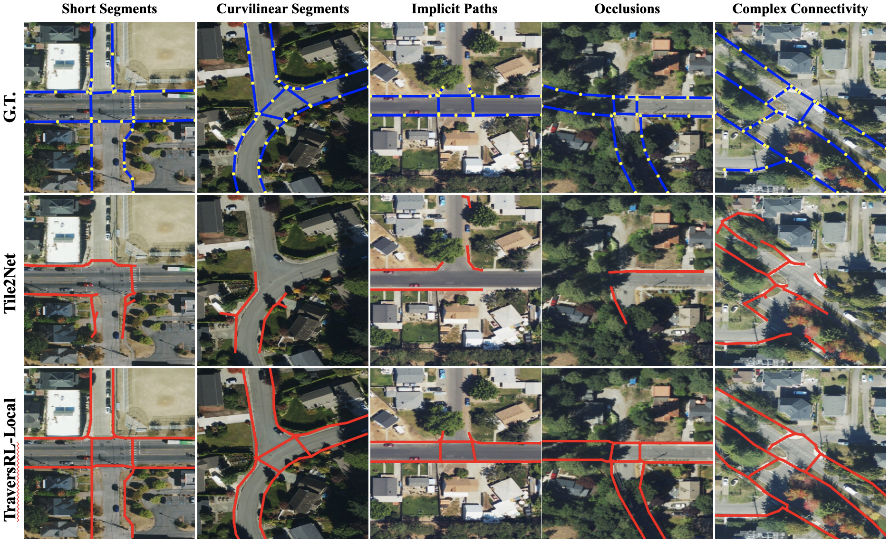

# TraversRL: Traversable Pedestrian Pathway Generation With Reinforcement Learning

This repository contains research code for **TraversRL**, a vision-conditioned framework for generating connected pedestrian pathway graphs from overhead imagery.

TraversRL treats pedestrian pathway extraction as an iterative graph-generation problem rather than a segmentation-only problem. Given an aerial image and a partial graph canvas, the model predicts direction-distance actions to grow a pedestrian network. The repository includes code for supervised pretraining, reinforcement-learning fine-tuning, practical segmentation-guided inference, and evaluation.

<p align="center">
  
</p>

## Repository Structure

```text
2026-pathway-generation/
├── pretraining/              # Supervised TraversRL-Pre training and rollout tuning
├── grpo_global/              # GRPO fine-tuning with terminal graph-level reward
├── grpo_local/               # GRPO fine-tuning with local stepwise reward shaping
├── evaluation/               # Inference, GeoJSON export, caching, and metrics
├── practical_usage/          # Deployment-style usage without ground-truth start nodes
│   ├── segmentation_seeding/          # Train segmentation model and generate seed points
│   └── segmentation_guided_inference/ # Run TraversRL from segmentation-derived seeds
├── requirements.txt          # Python dependencies
└── README.md
```

Detailed instructions are provided in each folder:

- [`pretraining/README.md`](pretraining/README.md)
- [`grpo_global/README.md`](grpo_global/README.md)
- [`grpo_local/README.md`](grpo_local/README.md)
- [`evaluation/README.md`](evaluation/README.md)
- [`practical_usage/README.md`](practical_usage/README.md)

## Environment Setup

Create a fresh environment:

```bash
conda create -n traversrl python=3.10 -y
conda activate traversrl
```

Install dependencies:

```bash
pip install -r requirements.txt
```

## Expected Data Format

The code expects a dataset root containing scene folders listed by index files.

```text
DATASET_ROOT/
├── pairs/
│   ├── <scene_id>/
│   │   ├── satellite.png
│   │   ├── graph.pickle
│   │   └── bbox.json
│   └── ...
├── train.txt
├── val.txt
└── test.txt
```

Each scene folder should include:

- `satellite.png`: overhead RGB image;
- `graph.pickle`: a NetworkX graph whose nodes are normalized `(x, y)` coordinates in `[0, 1]^2`;
- `bbox.json`: geographic bounding box used to export predictions as GeoJSON.

Expected `bbox.json` format:

```json
{"bbox": [min_lon, max_lon, min_lat, max_lat]}
```

## Paper Experiment Workflow

Our paper-experiments follow this order:

1. Update dataset/checkpoint paths in the relevant config files.
2. Train the supervised reference model in `pretraining/`.
3. Tune rollout parameters with `pretraining/parameter_tuning.py`.
5. Fine-tune with global reward in `grpo_global/` or local reward shaping in `grpo_local/`.
6. Run inference and evaluation from `evaluation/`.

This workflow is designed for controlled evaluation and uses ground-truth graph nodes as starting points during inference/evaluation.


## Practical Usage Workflow

In practice, ground-truth start nodes are unavailable. The `practical_usage/` folder provides a deployment-style workflow:

1. Train a segmentation model and generate high-confidence pathway seeds in `practical_usage/segmentation_seeding/`.
2. Run segmentation-guided TraversRL inference in `practical_usage/segmentation_guided_inference/`.

The segmentation-guided inference code uses an iterative coverage procedure: it starts from one seed, generates a path, accepts non-overlapping generations, removes covered seeds, and repeats until no uncovered seeds remain. This allows the system to handle scenes with multiple disconnected pathway components.

## Evaluation

Evaluation code is in `evaluation/`. It supports:

- GeoJSON prediction export;
- buffered IoU;
- TravSim / traversability similarity;
- graph statistics;
- ground-truth caching for faster repeated evaluation over the same dataset split.